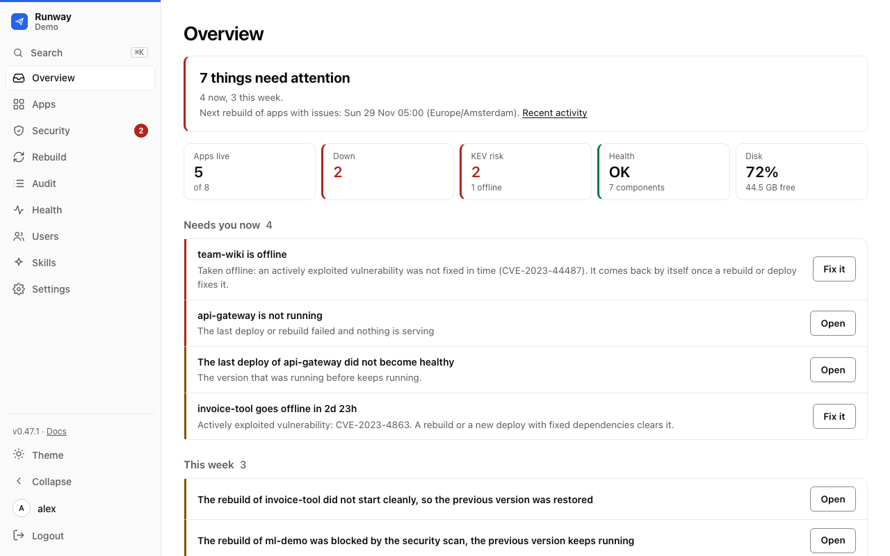
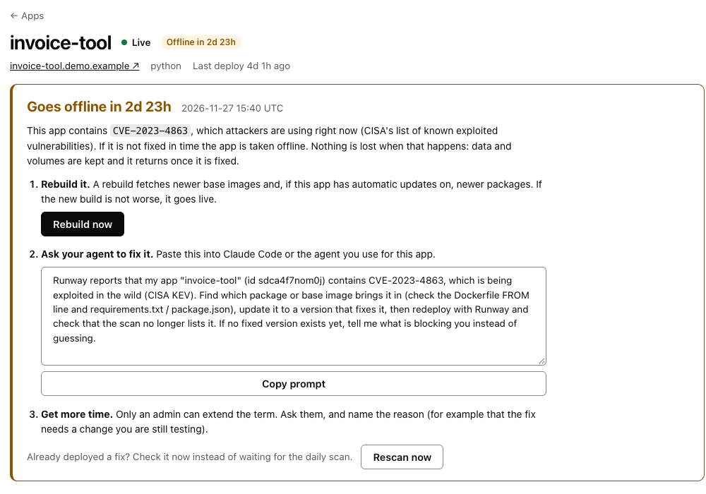
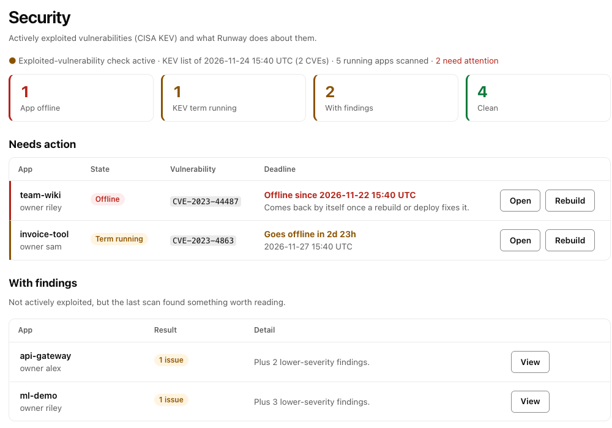
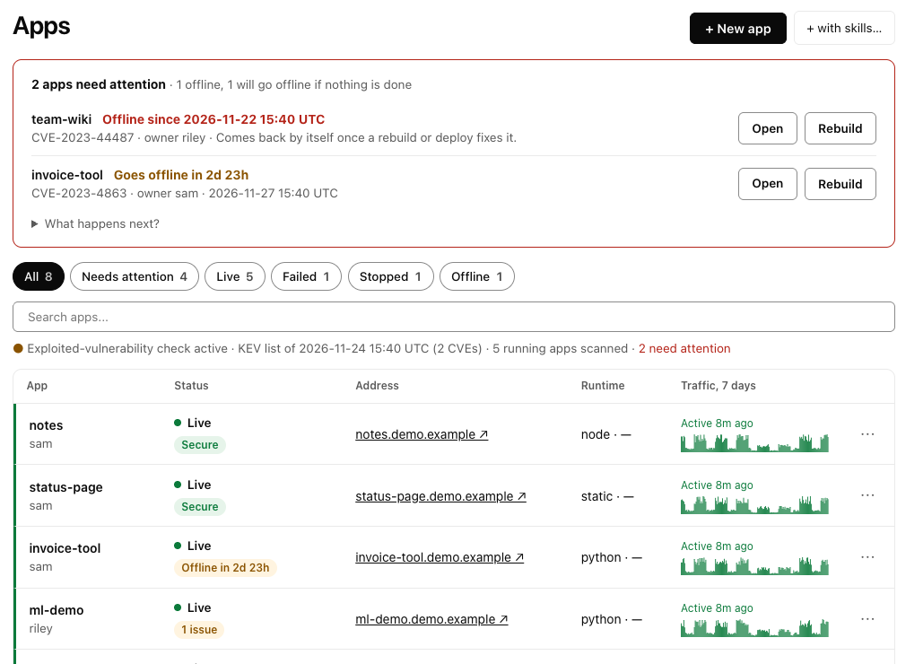
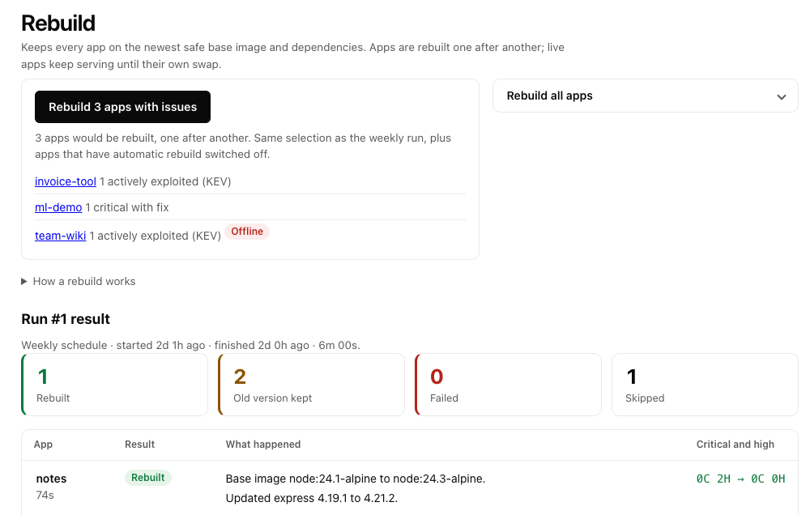
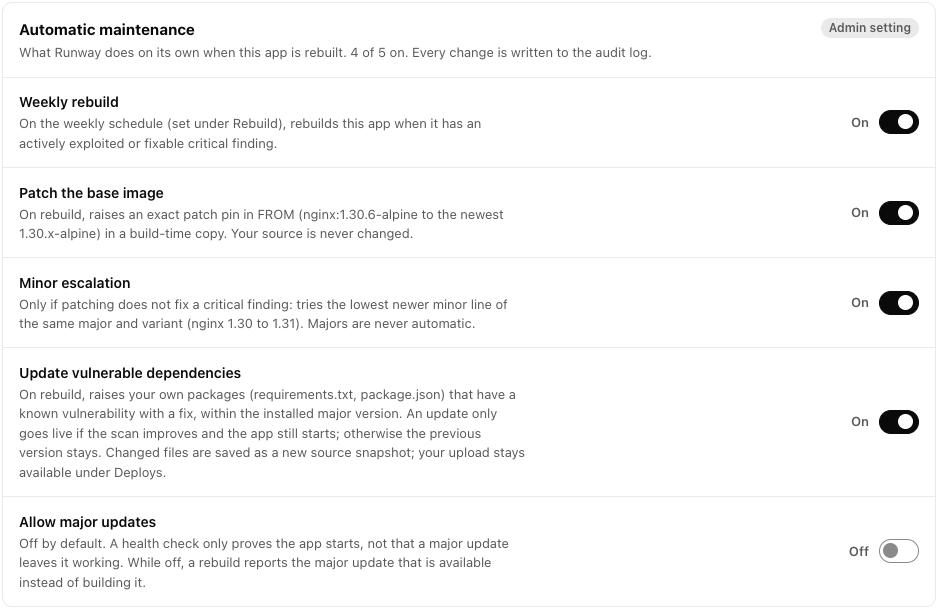
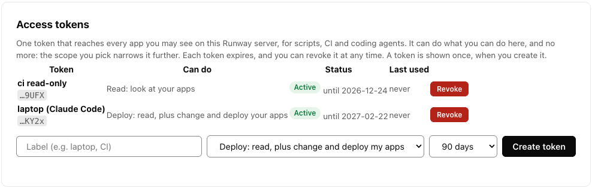
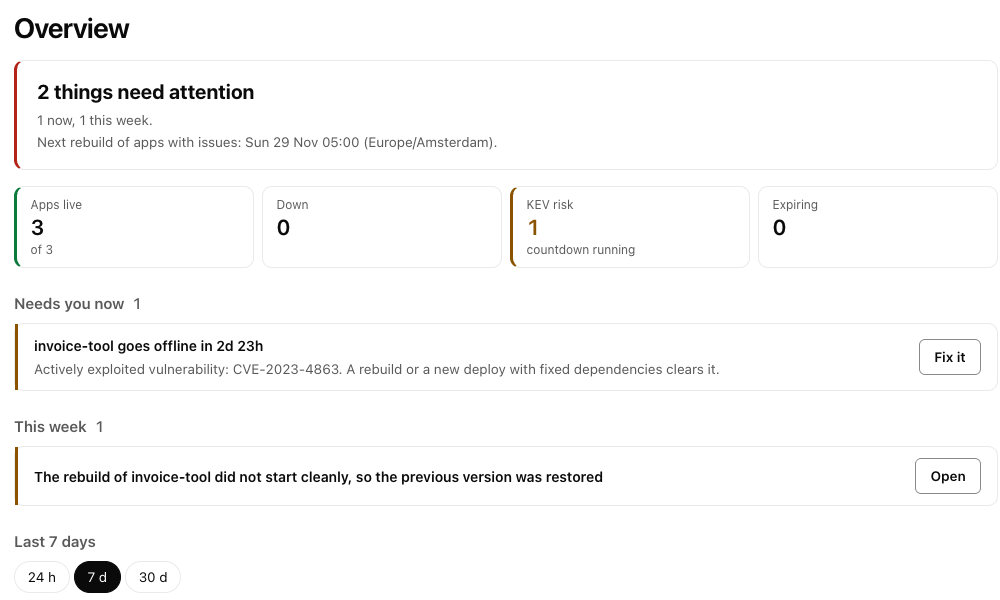
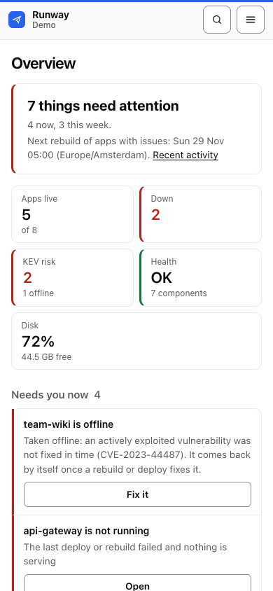
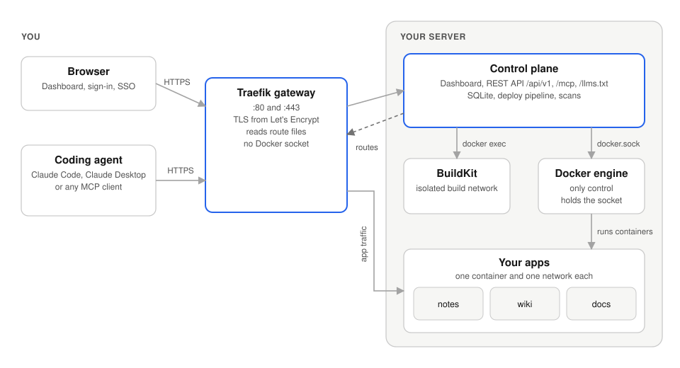

<h1 align="center">Runway</h1>

<p align="center">
  <strong>Deploy AI-built apps to your own server with one prompt, and keep them patched.</strong>
</p>

<p align="center">
  <a href="#quickstart">Quickstart</a> &middot;
  <a href="#what-you-get">What you get</a> &middot;
  <a href="#use-it-from-an-agent">Agents and MCP</a> &middot;
  <a href="#security">Security</a> &middot;
  <a href="#documentation">Docs</a>
</p>

Runway turns a Linux server into a deployment target. You tell Claude Code (or any
agent) to deploy a project; Runway builds it in an isolated builder, scans it, serves it
over HTTPS on its own subdomain and then keeps watching it: it rebuilds apps that pick up
dangerous vulnerabilities, and shows you, in one place, whether everything is fine and
what to do if it is not.

No CI/CD pipeline to set up, no Kubernetes. One server, one install command.

<p align="center">
  <picture>
    <source media="(prefers-color-scheme: dark)" srcset="docs/images/hero-dark.png">
    
  </picture>
</p>

## Why Runway

- **One-prompt deploys.** Your Runway publishes its own API documentation at
  `/llms.txt`. Tell an agent "deploy this to Runway" and it reads the docs, adds a
  Dockerfile if needed, uploads the source and reports the live URL.
- **Your server.** It runs on any VPS or your own hardware, and your code and data stay
  there. Runway itself only reaches out for what it needs: Let's Encrypt, Trivy's
  vulnerability database, the CISA KEV list, container registries, the OAuth providers you
  switch on, GitHub if you import skills, and a webhook you choose.
- **Safe by default.** Every deploy is scanned and can be blocked. Apps run in hardened
  containers on networks of their own. An actively exploited vulnerability starts a
  countdown that ends in a quarantine, so nobody has to remember to look.
- **Stays patched.** Rebuilds raise base-image patches and vulnerable dependencies, and
  go live only if the result is not worse and still starts.
- **Made for more than one person.** Admins and app owners, Google and Microsoft sign-in
  with an allowlist, per-app SSO, 2FA, scoped tokens for agents and an audit log.

## What you get

**A countdown, in plain words.** An actively exploited vulnerability (CISA KEV) gives the app's
owner a term. The app page says what it means and offers three steps: rebuild now, ask your
agent (with a prompt to copy), or ask an admin for more time.

<p align="center">
  <picture>
    <source media="(prefers-color-scheme: dark)" srcset="docs/images/app-kev-dark.png">
    
  </picture>
</p>

**One security page.** Every app with a running KEV term, a quarantine or a finding worth
reading, with its deadline and the button that fixes it. Members see only their own apps.

<p align="center">
  <picture>
    <source media="(prefers-color-scheme: dark)" srcset="docs/images/security-dark.png">
    
  </picture>
</p>

And more (click a picture to enlarge it):

<table>
  <tr>
    <td width="50%" valign="top">
      <a href="docs/images/apps-light.png"></a>
      <br><strong>One status per app.</strong> Live, Building, Failed, Stopped or Offline, one
      security chip, the address and a seven-day traffic sparkline. Filter by state or search.
    </td>
    <td width="50%" valign="top">
      <a href="docs/images/rebuild-light.png"></a>
      <br><strong>Rebuilds you can read.</strong> "Rebuild apps with issues" or all apps, and a
      result per app in words, with the findings before and after.
    </td>
  </tr>
  <tr>
    <td width="50%" valign="top">
      <a href="docs/images/maintenance-light.png"></a>
      <br><strong>Automatic maintenance.</strong> Five switches per app, each with its
      explanation. Major dependency updates are an opt-in.
    </td>
    <td width="50%" valign="top">
      <a href="docs/images/tokens-light.png"></a>
      <br><strong>Tokens for agents.</strong> One token per person reaches every app they may
      see, with a scope and an expiry, and you can revoke it at any time.
    </td>
  </tr>
  <tr>
    <td width="50%" valign="top">
      <a href="docs/images/overview-owner-light.png"></a>
      <br><strong>What an owner sees.</strong> Only their own apps and countdowns, a button to fix
      each one, and no server information.
    </td>
    <td width="50%" valign="top" align="center">
      <picture>
        <source media="(prefers-color-scheme: dark)" srcset="docs/images/mobile-overview-dark.png">
        
      </picture>
      <br><strong>On a phone too.</strong> The sidebar becomes a top bar and tables become cards.
    </td>
  </tr>
</table>

Also in the box: a command palette (`Ctrl K` or `Cmd K`) that jumps to pages and apps,
light and dark themes that follow your system, a colour and name per instance so you can
tell several Runways apart, server disk, CPU, memory and Docker data for admins, custom
domains with automatic certificates, environment variables, persistent volumes, health
checks, deploy history with one-click rollback, source you can pull back to a new machine,
HTTP basic auth and SSO per app. See [Deploying and running apps](docs/deploying-apps.md).

## Quickstart

You need a Linux server you can `sudo` on (Ubuntu, Debian, CentOS, RHEL, Fedora, Rocky or
Alma), a domain, and ports 80 and 443 open to the internet. Allow a few minutes, mostly for
DNS and the certificate.

**1. Point DNS at the server.** An A record for the dashboard (`runway.example.com`) and a
wildcard record (`*.runway.example.com`), so each app gets its own subdomain.

**2. Run the installer.**

```bash
curl -fsSL https://raw.githubusercontent.com/wiggertdehaan/Runway/main/install.sh | sudo bash
```

It asks for the dashboard domain and an email for Let's Encrypt (or pass them as
`DASHBOARD_DOMAIN` and `ACME_EMAIL`, see [Configuration](docs/configuration.md#the-installer)),
installs Docker if it is missing, starts the stack and waits for the certificate. At the end
it prints a **setup token**. Lost it? `docker logs runway-control 2>&1 | grep -i "setup token"`.

**3. Create your admin account.** Open `https://runway.example.com/setup`, paste the setup
token and choose a username and password. Turn on 2FA on the Account page.

**4. Deploy something.** Click **New app**, copy the deploy instruction and paste it into
Claude Code in your project. When it finishes, your app is live at
`https://<name>.runway.example.com`.

## Use it from an agent

Three ways in, all on the same API and the same rights. Pick by how much setup you want.

| Way in | Setup | Good for |
|---|---|---|
| **`/llms.txt`** | none: paste the deploy instruction | one app, any agent that can run `curl` |
| **Skill server** | `claude mcp add runway-skills --transport http https://runway.example.com/mcp --header "Authorization: Bearer rwd_..."` | Claude Code, with built-in deploy and debug skills |
| **Local MCP server** | clone, `pnpm mcp:build`, register | typed tools, for one app or for many apps on many Runways |

The local MCP server can hold **one connection for several Runways**, say a personal one, a
club one and a company one. Put a user token per server in `~/.runway/config.json`:

```json
{
  "runways": [
    { "name": "home",    "url": "https://runway.example.com", "token": "rwu_..." },
    { "name": "company", "url": "https://runway.example.net", "token_env": "RUNWAY_TOKEN_COMPANY" }
  ]
}
```

Then register it in Claude Code with `claude mcp add runway -s user -- node $(pnpm mcp:path)`
(Claude Desktop is a few lines of JSON) and ask "list my Runways". The agent chooses the Runway
and the app on each call. A token only ever goes to its own server and never shows up in tool
output. The servers know nothing of each other.

Agents can also ask **what happened**, without polling the dashboard: `runway_events` returns
deploys that finished or failed, health changes, rebuild results, KEV deadlines and quarantines,
as a type, an app id and a fixed code, never logs or secrets.

Everything is in [MCP and agents](docs/mcp.md).

## How it works

<p align="center">
  <picture>
    <source media="(prefers-color-scheme: dark)" srcset="docs/images/architecture-dark.svg">
    
  </picture>
</p>

Traefik terminates TLS and routes to the control plane and to your apps, from route files that
control writes. Control is one Node.js process with the dashboard, the API, the MCP endpoints
and the schedulers, backed by SQLite. Builds run in a separate BuildKit container. Each app is
one container on its own network. Details in [Architecture](docs/architecture.md).

## Security

What Runway does:

- **Builds are isolated.** Source is checked before it is unpacked (no unsafe links, paths or
  oversized archives) and built in a separate BuildKit container on a network of its own.
- **Apps are isolated.** One Docker network per app, reduced Linux capabilities,
  `no-new-privileges`, a process limit and rotated logs. Traefik has no Docker socket.
- **Every deploy is scanned** with Trivy (image CVEs, secrets in source, Dockerfile
  misconfigurations) against a threshold you set, and running apps are rescanned daily.
- **Actively exploited vulnerabilities** (CISA KEV) start a countdown, then a last rebuild,
  then a quarantine behind a maintenance page.
- **People.** Passwords hashed with scrypt, host-only session cookies, CSRF protection,
  optional 2FA with a per-user lockout, OAuth sign-in only for an allowlist, and owners who
  see only their own apps.
- **Tokens** are stored as hashes, scoped, expiring and revocable, rate limited per token
  and every change they make is in the audit log (field names, never values).

What it does not do, honestly: the control container runs as root and holds the Docker
socket, so a compromise of control is root on the host. BuildKit is privileged, so treat
the right to deploy as trusted. The host firewall rules that keep apps away from the cloud
metadata address and private networks are an opt-in step. The full picture, with the limits,
is in [Security](docs/security.md). To report a vulnerability, see [SECURITY.md](SECURITY.md).

## Configuration

Most installs only ever set the two values the installer asks for. The rest has defaults. The
ones you are most likely to touch, in `.env` next to `docker-compose.yml`:

| Variable | Default | Meaning |
|---|---|---|
| `DASHBOARD_DOMAIN` | asked | Dashboard hostname. |
| `ACME_EMAIL` | asked | Let's Encrypt email. |
| `SETUP_TOKEN` | generated | One-time token for `/setup` until the first admin exists. |
| `RUNWAY_HARDENING` | `standard` | `standard`, `strict` or `relaxed` (emergency brake). |
| `RUNWAY_APP_NETWORK_MODE` | per-app networks | `shared` goes back to one shared network (emergency brake). |
| `PERIODIC_SCAN_INTERVAL_HOURS` | `24` | Hours between background scans of running apps. |
| `HOST_METRICS_INTERVAL_MS` | every minute | Server figures for the overview. `0` turns them off. |

After a change run `docker compose up -d` in `/opt/runway`. Everything else, the rate limits,
retention, upload limits, and the settings under **Settings** in the dashboard, is in
[Configuration](docs/configuration.md).

## Documentation

| Page | What is in it |
|---|---|
| [Deploying and running apps](docs/deploying-apps.md) | Deploy, environment, volumes, domains, health, rollback, SSO, roles, scanning. |
| [MCP and agents](docs/mcp.md) | `/llms.txt`, the skill server, the local MCP server, several Runways, tokens, events. |
| [Operations](docs/operations.md) | Updating Runway, rebuilds and patching, KEV quarantine, server figures, egress rules, upgrade notes. |
| [Security](docs/security.md) | The model, what is protected and how, known limits, hardening checklist. |
| [Configuration](docs/configuration.md) | Installer options, environment variables, dashboard settings, where state lives. |
| [Architecture](docs/architecture.md) | The pieces, a deploy step by step, networks, tech stack, working on Runway. |

## Not there yet

- Invite links for password accounts: an admin still sets a temporary password. (Google and
  Microsoft sign-in do have invitations.)
- More than one custom domain per app.
- Audit log export and date filters.
- Running control without root.
- Automatic dependency updates for yarn, pnpm and bun lockfiles, `pyproject.toml` and Pipfile.

Contributions are welcome. See [CONTRIBUTING.md](CONTRIBUTING.md); work happens on `develop`.

## License

MIT, see [LICENSE](LICENSE).
