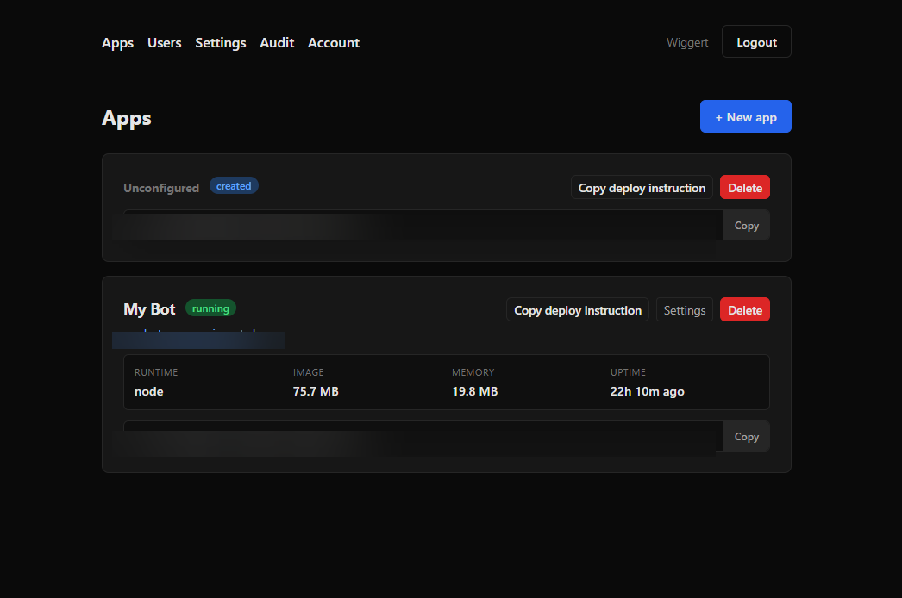
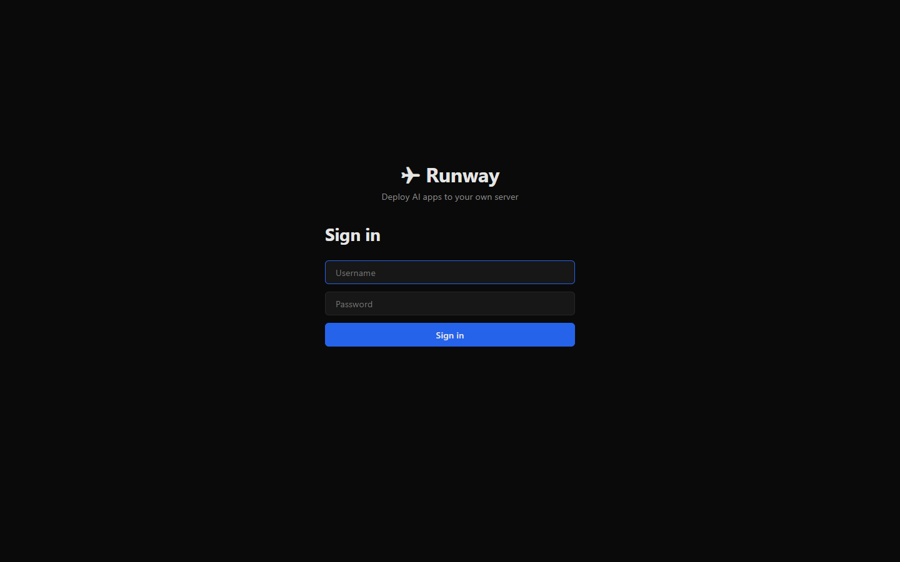
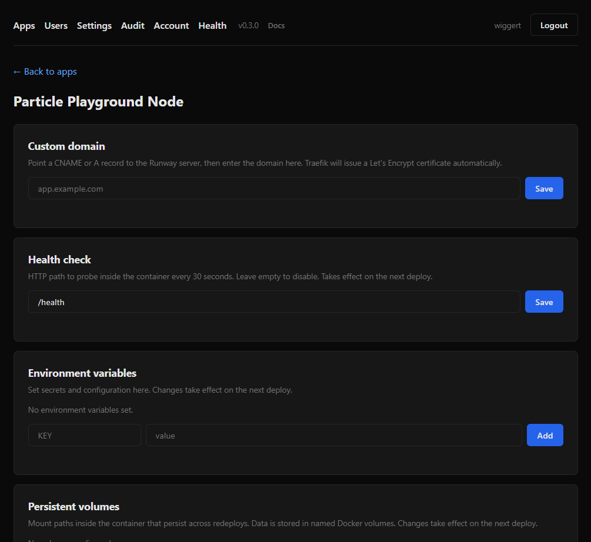
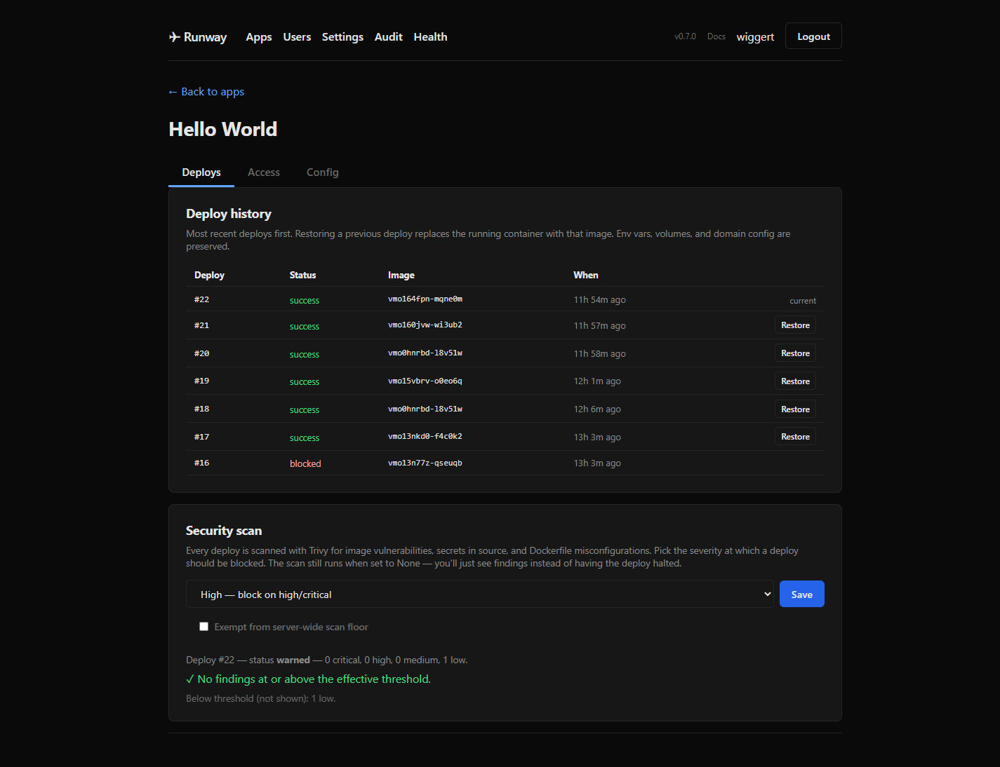
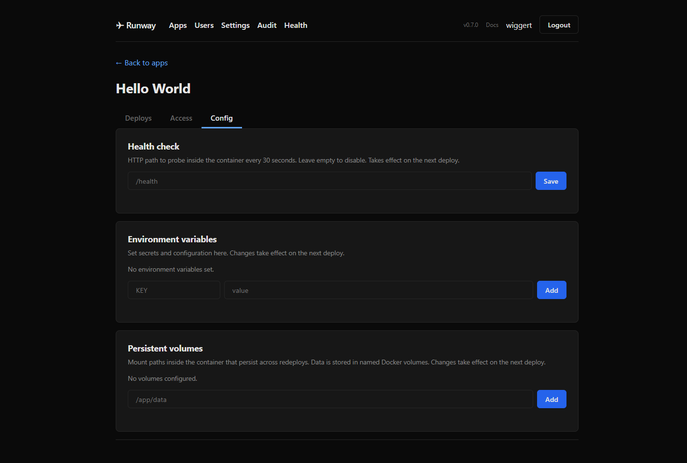
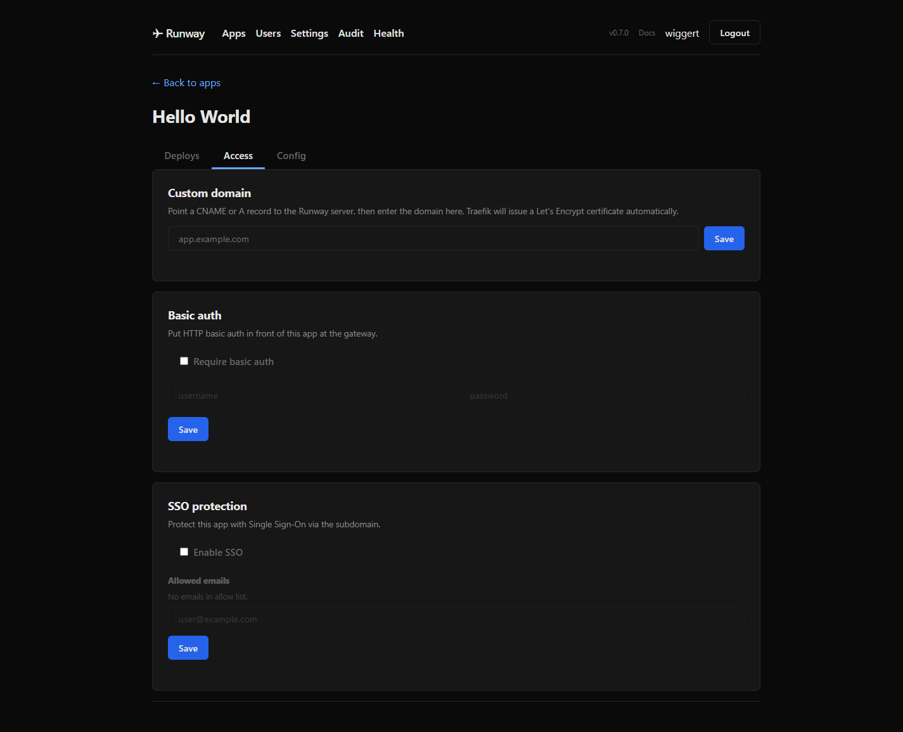
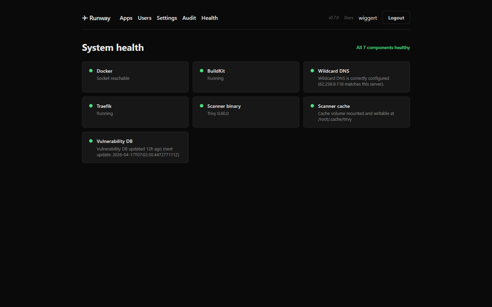

<p align="center">
  <h1 align="center">Runway</h1>
  <p align="center">
    <strong>Deploy AI apps to your own server with one prompt.</strong>
  </p>
  <p align="center">
    <a href="#install">Install</a> &middot;
    <a href="#how-it-works">How it works</a> &middot;
    <a href="#deploying-an-app">Deploy an app</a> &middot;
    <a href="#features">Features</a> &middot;
    <a href="#development">Development</a>
  </p>
</p>

---

Runway is an open-source platform that turns any Linux server into a
deployment target for AI applications. Install it with one command,
generate an API key, and tell Claude Code to deploy — it handles
Dockerfiles, builds, TLS certificates, and routing automatically.

No CI/CD pipelines to configure. No Kubernetes. Just your code and a
server.



## Why Runway?

- **One-prompt deploys** — tell Claude Code *"deploy this to Runway"*
  and it reads the API docs from your server, builds a Docker image,
  and puts it online with HTTPS.
- **Your server, your data** — runs on any VPS (Hetzner, DigitalOcean,
  your own hardware). Nothing leaves your infrastructure.
- **Zero config for simple apps** — Runway generates Dockerfiles for
  Node.js, Python, Go, and static sites. Bring your own Dockerfile for
  full control.
- **Production features built in** — environment variables, persistent
  volumes, custom domains, health checks, deploy rollback, 2FA, audit
  logging, admin/member roles, per-app HTTP basic auth, SSO with
  Google/Microsoft OAuth2, and a per-deploy security scan (Trivy) with
  a configurable severity gate.

## How it works

```
Your machine                            Your server
┌──────────────────┐                   ┌──────────────────────────────┐
│                  │                   │  Runway                      │
│  Claude Code     │── GET /llms.txt ─>│  ├─ Dashboard (web UI + API) │
│                  │── tar upload ────>│  ├─ BuildKit (isolated builds)│
│  "deploy this    │                   │  ├─ Traefik (TLS + routing)  │
│   to Runway"     │<── https://app ──│  └─ Your app containers      │
│                  │                   │                              │
└──────────────────┘                   └──────────────────────────────┘
```

1. **Install Runway** on your server with one command.
2. **Create an app** in the dashboard — you get an API key.
3. **Tell Claude Code** to deploy your project with that key.
4. **Your app is live** at `https://your-app.your-domain.com` with a
   Let's Encrypt certificate.

## Install

On a fresh Linux server (Ubuntu, Debian, CentOS, RHEL, Fedora, Rocky,
Alma):

```bash
curl -fsSL https://raw.githubusercontent.com/wiggertdehaan/Runway/main/install.sh | sudo bash
```

The installer prompts for your dashboard hostname and a Let's Encrypt
email. If you'd rather pass them up-front (useful for unattended
installs), set them as environment variables:

```bash
curl -fsSL https://raw.githubusercontent.com/wiggertdehaan/Runway/main/install.sh \
  | sudo DASHBOARD_DOMAIN=runway.example.com ACME_EMAIL=you@example.com bash
```

**Requirements:**
- A domain name with a DNS A record pointing to the server
- A wildcard DNS record (`*.runway.example.com`) for automatic app subdomains
- Ports 80 and 443 open

The installer sets up Docker, configures the firewall, starts the
Runway stack, and waits up to two minutes for Let's Encrypt to issue
the dashboard certificate. Open `https://runway.example.com` to create
your admin account. If the cert isn't issued in time, the installer
prints specific troubleshooting commands.

## Deploying an app

### Option A — zero install (recommended)

Your Runway server publishes its full API documentation at `/llms.txt`,
including a pre-build *"Before you start building"* section with
runtime-agnostic guardrails (non-root, pinned versions, health checks)
and a per-runtime security checklist — so Claude Code gets the project
right on day one and the first deploy passes the scan. No plugins or
MCP servers needed.

1. Create an app in the dashboard and copy the deploy instruction.
2. Open your project in Claude Code and paste it.
3. Done. Claude handles the Dockerfile, build, and deploy.

### Option B — Built-in skill server (recommended for Claude Code)

Runway hosts an MCP-based skill server alongside the dashboard.
Generate a developer token on `/account`, copy the one-line install
command, paste it into a terminal, and Claude Code picks up four
built-in skills:

- `runway-bootstrap` — set up a Runway-friendly project layout
- `runway-deploy` — push a deploy
- `runway-fix-scan-finding` — diagnose Trivy findings
- `runway-debug-deploy-fail` — diagnose failed deploys

```bash
claude mcp add runway-skills --transport http \
  https://runway.example.com/mcp \
  --header "Authorization: Bearer rwd_..."
```

No clone, no per-project install — the skills come straight from
your Runway instance and stay current as the platform evolves.
Admins can also import **curated** skills directly from public
GitHub repos (e.g. `anthropics/skills/pdf`) — Runway fetches the
bundle, hashes it (SHA-256), and marks it `signed` if the org is in
the trusted-publisher whitelist. Or paste your own **custom**
SKILL.md into the dashboard for org-specific guidance (house style,
internal API conventions, etc.). All three layers are served over
the same MCP endpoint.

### Option C — Local MCP server (legacy, app-scoped)

The original per-app MCP server still works for power users who want
structured tool calls (deploy, env, volumes) instead of `curl`:

```bash
git clone https://github.com/wiggertdehaan/Runway.git
cd Runway && pnpm install && pnpm mcp:build

claude mcp add runway \
  -s project \
  -e RUNWAY_URL=https://runway.example.com \
  -e RUNWAY_APP_KEY=rwy_... \
  -- node $(pnpm mcp:path)
```

Then just say *"deploy this to Runway"* in any Claude Code session. This
is the per-app way: the key (`rwy_...`) is one app, and it works exactly as
it always has. For several apps or several Runway servers use Option D.

#### Events: what happened, without polling

`GET /api/v1/events?since=<cursor>` (and the MCP tools `runway_events` and
`runway_event_detail`) tell an owner or their agent what happened to an app:
a deploy ended, health changed, a rebuild finished, an actively exploited
vulnerability (KEV) deadline is near, a dependency was updated or rolled back,
an exemption is ending. An event is a type, an app id and a code from a fixed
list; it never carries logs, environment variables, error messages or text
from the app. The caller keeps the cursor and asks again (pull, works in every
client); a user token (`rwu_`) sees exactly the apps that person may see. Events
are kept 30 days / 500 per app (`EVENTS_RETENTION_DAYS`, `EVENTS_MAX_PER_APP`);
`HEALTH_WATCH_INTERVAL_MS=0` turns off the health watcher that raises
`health_unhealthy` / `health_recovered`. Full list of codes: `/llms.txt`.

### Option D — One MCP connection for all your apps, on several Runways

For power users who manage more than one app, or more than one Runway
server (say a personal one, a club one and a company one). The local MCP
server (the same `packages/mcp`) reads a small config file, holds one
**user token** per server and lets the agent pick the Runway and the app on
each call. The servers know nothing of each other: only your local MCP
process bundles them, and each request carries only the token of the server
it goes to.

**1. Make a token on each server.** Sign in, open **Account > Access
tokens**, give it a label, pick a scope and an expiry, and copy the token
(`rwu_...`) once; it is shown only then.

| Scope | Lets the agent |
|---|---|
| `read` | list apps, read status, logs, scans and events |
| `deploy` | everything above, plus deploy, rebuild, rescan, configure, env, domain |
| `admin` | administrator actions (only works while you are an administrator) |

A token sees the apps you may see (as owner: your own apps; as administrator:
all of them), with the same rights as the dashboard, decided on every request.
It expires (90 days by default, one year at most) and you, or an administrator,
can revoke it at any time on the same page. Pick the smallest scope that does
the job.

**2. Write the config** to `~/.runway/config.json` (or point `RUNWAY_CONFIG`
at another file) and keep it private (`chmod 600`; the client warns if other
users can read it):

```json
{
  "runways": [
    { "name": "home",    "url": "https://runway.example.com",  "token": "rwu_..." },
    { "name": "club",    "url": "https://apps.example.org",    "token_env": "RUNWAY_TOKEN_CLUB" },
    { "name": "company", "url": "https://runway.example.net",  "token_env": "RUNWAY_TOKEN_COMPANY" }
  ]
}
```

- `name`: what you and the agent call it (lowercase letters, digits, `-`, `_`).
- `token` or `token_env`: the token itself, or the name of an environment
  variable that holds it, so it need not be in the file.
- `url` must be `https://` (plain `http://` only for `localhost`, or with
  `"allow_insecure": true` on a network you control).
- Optional `"app_keys": { "<app id>": "rwy_..." }` gives per-app keys for apps
  you cannot reach with a token; the key wins for that app.
- A field the client does not know is an error, not ignored, so a typo cannot
  silently mean "no token".

One server only? `RUNWAY_URL` plus `RUNWAY_TOKEN` in the environment works
without a file. Without a file and without `RUNWAY_TOKEN`, the old
`RUNWAY_URL` + `RUNWAY_APP_KEY` mode (Option C) is used, unchanged.

**3. Register it.** Build once (`pnpm install && pnpm mcp:build`), then:

```bash
# Claude Code
claude mcp add runway -s user -- node $(pnpm mcp:path)
```

```jsonc
// Claude Desktop: claude_desktop_config.json
// macOS: ~/Library/Application Support/Claude/claude_desktop_config.json
// Windows: %APPDATA%\Claude\claude_desktop_config.json
{
  "mcpServers": {
    "runway": {
      "command": "node",                                  // use the full path to node if Desktop cannot find it
      "args": ["/path/to/Runway/packages/mcp/dist/index.js"],
      "env": { "RUNWAY_CONFIG": "/Users/you/.runway/config.json" }
    }
  }
}
```

Restart the client, then ask *"list my Runways"*.

**Adding another Runway later:** make a token on that server, add an entry
to `config.json` (or a `token_env` and export the variable), restart the MCP
connection, ask *"list my Runways"* to see it answer and when its token expires.

**How it is used.** With a config the app tools take two extra arguments,
`runway` (optional when only one server is configured, required, and never
guessed, when there are several) and `app` (needed with a user token; ids come
from `runway_list_apps`). New tools: `runway_list_runways` (name, address,
whether it answers, whether the token is valid, scope, expiry; never the
token), `runway_list_apps` (all your apps, grouped by server; one server being
down does not hide the others), `runway_create_app`, `runway_rebuild` and
`runway_rescan` (you may rebuild and rescan apps you own). `runway_events`
asks every server at once and keeps one cursor per server: pass the `next`
map it returned back as `since`.

What the client guarantees: a token is only ever sent to its own server (a
redirect is never followed, so it cannot be replayed elsewhere), never appears
in tool output, error messages or logs, and every server answer is rebuilt field
by field before the model sees it; text that came from an app stays fenced as
untrusted. A server that is slow, down or rate limiting (HTTP 429) is
reported on its own and does not stop the others.

## Features

### Environment variables

Store secrets and configuration on the server — never bake them into
your Docker image. Set them via the dashboard, API, or MCP tools.
Changes take effect on the next deploy.


### Persistent volumes

Mount paths inside your container that survive redeploys. Backed by
named Docker volumes — perfect for SQLite databases, file uploads, or
caches.

### Custom domains

Point your own domain at any app. Traefik issues a Let's Encrypt
certificate automatically. Just add a DNS record and configure the
domain in the app settings.

### Health checks

Configure an HTTP endpoint to probe. Docker checks it every 30 seconds
and marks the container unhealthy after 3 failures — so you know when
something is actually broken, not just running.

### Deploy history & rollback

Every deploy is recorded with its image tag, status, and scan summary.
The app detail page shows the last 20 deploys and a one-click
**Restore** button on any successful historical version — useful when
a bug only shows up two deploys later. The same is available via the
API (`GET /app/deploys`, `POST /app/rollback` with optional
`deploy_id`) and the MCP (`runway_list_deploys`, `runway_rollback`).
Env vars, volumes, and domain config stay untouched; only the
container image changes.

### Pull project source

Runway keeps the build context of every successful deploy, so you can
pull a codebase back to a fresh machine without a separate git host —
handy when a teammate built an app and you want to continue it, or you
just lost your local checkout. Download any retained snapshot from the
deploy history table in the dashboard, via the API
(`GET /app/source`, optional `?deploy=<id>`), or with the MCP
(`runway_pull`, optional `deploy`). The most recent snapshots are kept
(default 10, `RUNWAY_SOURCE_RETENTION`). The tarball is the uploaded
file set after `.dockerignore`/`.gitignore` filtering — `.git` history
is not included, so `git init` after extracting if you want version
control.

### Basic auth

Put HTTP basic auth in front of any app at the gateway with one
toggle in the dashboard (or one MCP call). Useful for password-
protecting an internal tool without writing login code. Credentials
are hashed before they hit disk and the route is re-written on the
fly, no redeploy required. For multi-user access control, use SSO
instead.

### Single Sign-On (SSO)

Sign in to the Runway dashboard with Google or Microsoft. Admin
configures OAuth2 client credentials on the Settings page; the login
screen then shows provider buttons alongside the regular password
form.

For deployed apps, SSO acts as a gateway-level auth layer. Toggle
"SSO protection" on the app detail page and manage an email
allowlist — only users with a matching Runway account can reach the
app. Traefik's forward-auth middleware checks a per-app sign-in cookie on
every request; no code changes in the app needed.

- **Provider support**: Google OAuth2 and Microsoft OAuth2.
- **Auto-provisioning**: first-time OAuth users get a `member`
  account linked by email.
- **Email allowlist**: per-app, managed via dashboard, API
  (`PUT /app/sso`), or MCP (`runway_set_sso`).
- **Cookie scope**: the dashboard session cookie is host-only, so a
  deployed app never receives it. Each SSO app host (the Runway address
  and a custom domain alike) gets its own short-lived cookie after a
  one-time redirect through the dashboard, and that cookie is valid for
  that host only. Signing out of the dashboard ends them all.
- **Precedence**: when both SSO and basic auth are enabled on an
  app, SSO takes precedence.

### Roles

Two roles: **admin** and **member**. The first account created through
the setup wizard is an admin. Admins can promote or demote anyone else
(except the last remaining admin, which the UI refuses). Members can:

- Create, configure, deploy, roll back, and delete **their own** apps
- Manage their own env vars, volumes, domains, health checks, and scan
  threshold
- Change their own password and 2FA on `/account`

Members cannot reach `/users`, `/settings`, `/audit`, or `/health`, and
they only see apps they created on the dashboard. Existing installs
are migrated with every current user promoted to admin — nobody loses
access on upgrade.

### Security scanning

Every deploy is scanned with [Trivy](https://trivy.dev) before the new
container replaces the old one. Three passes run in parallel:

- **Image vulnerabilities** — OS packages and language dependencies
  matched against the CVE database.
- **Secrets in source** — hardcoded API keys, tokens, and credentials
  in the uploaded project.
- **Dockerfile misconfigurations** — running as root, missing
  `HEALTHCHECK`, remote `ADD`, and similar gotchas.

Each app has a `scan_threshold` (`none` / `low` / `medium` / `high` /
`critical`). When a finding meets the threshold, the deploy is blocked:
the image is built but never started, and the previously running
container keeps serving traffic. Findings are available in the deploy
response, on the dashboard, and via `runway_get_scan` from the MCP.

A **periodic rescan** runs Trivy against every running app's current
image once a day so CVEs published after the deploy gate ran still
surface. The latest result is shown on the app detail page, and a
new HIGH/CRITICAL finding (compared to the previous periodic scan)
fires the configured webhook. There is also a manual *"Rescan now"*
button for admins.

### Security

- Passwords hashed with scrypt, constant-time comparison
- CSRF protection (double-submit cookie with timing-safe comparison)
- Optional TOTP two-factor authentication with backup codes
- Login rate limiting (5 attempts / 15 minutes per IP), persisted in SQLite
- API rate limiting per key (120 reads / 60 writes per minute, 10 deploys per 10 minutes) and per address (see below)
- Per-app API keys, independent from dashboard sessions, stored as hashes (shown once), rotatable with an optional overlap
- User tokens (`rwu_`): one token per person for every app they may see, with a scope (read / deploy / admin), an expiry, and revocation by the person or an administrator
- Audit log for all admin actions
- Events (a fixed vocabulary, pulled with a cursor): no logs, env or app text in them; text that came from an app is cut short and marked as untrusted
- Content Security Policy headers
- Isolated builds via BuildKit (user code never touches the Docker socket)
- One Docker network per app: apps cannot reach each other or the control plane; optional host egress rules keep them off the cloud metadata address, the host and private networks
- Hardened app containers: reduced Linux capabilities, no new privileges, a process limit, no swap, rotated logs, and an opt-in read-only root filesystem per app (`standard` / `strict` / `relaxed` profile; `RUNWAY_HARDENING=relaxed` is the emergency brake, takes effect at an app's next deploy or rebuild)
- Traefik has zero Docker socket access
- Per-deploy Trivy scan (image CVEs, hardcoded secrets, Dockerfile misconfigs) with a configurable blocking threshold
- Two-role access model (admin / member) with per-user ownership of apps

## Keeping Runway and its apps patched

Two separate things go stale: Runway's own containers, and the images
of the apps it deployed.

**Runway itself** (gateway, BuildKit, control). Images are pinned in
`docker-compose.yml`: Traefik on a minor tag (`v3.5`, picks up patch
releases) and BuildKit on an exact release (`moby/buildkit:v0.35.1`,
never `latest`). To update on the host, from the install directory
(`/opt/runway`):

```bash
git pull                        # picks up new pins + control changes
docker compose pull             # fetch pinned images (patch releases)
docker compose up -d --build    # recreate what changed, rebuild control
```

That sequence is safe to put in a scheduled job: `up -d` only recreates
containers whose image or config changed, and deployed apps live in
separate containers and are not touched. To move BuildKit or Traefik to
a newer release, bump the tag in `docker-compose.yml` first.

**Deployed apps.** An app only becomes safe when it is rebuilt, and the
BuildKit cache (kept 7 days) can replay an old `apt-get upgrade` layer.
Admin > **Rebuild** rebuilds apps from their stored source with
`buildctl --no-cache`, through the normal scan gate; a new container
that is not healthy within two minutes is replaced by the previous
deploy automatically.

- **Rebuild all apps now**: sequential, with a per-app result
  (rebuilt / rolled back / blocked / failed) and findings before and
  after, including actively exploited CVEs from the CISA KEV catalog.
- **Weekly automatic rebuild** (default Sunday 05:00 Europe/Amsterdam,
  configurable on the same page): rebuilds only apps with a KEV CVE or
  a critical finding that has a fix. Individual apps can opt out on
  their app page. The result goes to the notification webhook.
- **Automatic base-image patches**: when a `FROM` pins an exact patch
  (`nginx:1.30.6-alpine`, `python:3.12.7-slim`), a rebuild looks up the
  newest patch of the **same major.minor and the same variant** in the
  registry and builds with that tag (`nginx:1.30.7-alpine`) from a
  build-time copy of the Dockerfile. Your stored source is never
  modified. Never a different minor/major; digest pins and floating tags
  (`1.30-alpine`, `node:24`, `latest`) are left alone; `ARG`-driven
  `FROM`s are supported when one ARG carries the tag or the whole image.
  Per app: "Auto-patch base image on rebuild" (default on). The base
  images used (tag + digest, and whether auto-raised) are recorded per
  deploy and shown in deploy history and the rebuild table. For fewer
  surprises, write minor pins (`nginx:1.30-alpine`) in your Dockerfile.
- **Automatic minor escalation** (per app, `auto_minor_base`, default
  on): if, after the patch bump, a rebuild still leaves an actively
  exploited (KEV) CVE or a CRITICAL that has a fix, runway tries the
  **lowest newer minor line** of the same major and variant (an exact pin
  `nginx:1.29.8-alpine` becomes `nginx:1.30.7-alpine`, a minor pin
  `1.29-alpine` becomes `1.30-alpine`), at most three lines, only for the
  runtime (final) stage. A minor is used only if it resolves **all**
  targeted findings, is not worse than the running version, and passes
  its healthcheck; otherwise the previous version stays. Each jump is
  announced (webhook + a notice on the app page) and shown in the deploy
  history as `auto-minor 1.29→1.30`. A newer **major** is never applied:
  runway only builds and scans it in a dry run and tells the owner
  "major X resolves Y".
- **Rebuild gate**: a rebuild goes live only if it is *not worse* than
  the running version (no new CRITICAL and no new actively exploited
  CVE compared with a fresh scan of the running image) **and** the new
  container passes its healthcheck. Otherwise the old version keeps
  running and the reason is reported (rebuild table + webhook). The
  app's `scan_threshold` still gates normal deploys, not rebuilds.
- **KEV quarantine**: an actively exploited CVE (CISA KEV) in a running
  app's **runtime** packages (the final image; build stages never count)
  starts a term (admin setting on the Rebuild page, default 7 days) with a
  notice on day 0 (app page, dashboard, webhook). When the term ends,
  runway makes one last rebuild attempt (with minor escalation); if the CVE
  is still there the app is **quarantined**: its hostnames are routed to a
  public maintenance page (HTTP 503) through the gateway and the container
  is stopped. Named volumes and data stay. As soon as a rebuild or deploy
  produces an image without the CVE the app comes back online by itself
  (a quarantined app only returns with a KEV-free build, and is never
  restored to the vulnerable image). An admin can grant a time-boxed
  **exemption** (reason + end date, max 90 days, audit-logged) on the app
  page; granting one lifts an active quarantine. Ordinary criticals never
  quarantine anything. Quarantine state shows on the dashboard, the app
  page, the Rebuild page and in webhook messages.
- **Scripting**: `POST /admin/api/rebuild-all` (202 + `run_id`),
  `GET /admin/api/rebuild-runs[/<id>]`. Requires an admin dashboard
  session cookie and the header `X-Requested-With: runway`; per-app API
  keys cannot call it.

## Dashboard

The web dashboard lets you manage apps, users, and settings.

| Login | Dashboard | Settings |
|:---:|:---:|:---:|
|  |  |  |

| Deploy history | Config | Access & SSO |
|:---:|:---:|:---:|
|  |  |  |

| System health |
|:---:|
|  |

## Tech stack

| Component | Technology |
|-----------|-----------|
| Language | TypeScript |
| Runtime | Node.js 24 (`node:sqlite`) |
| Web framework | [Hono](https://hono.dev/) + [htmx](https://htmx.org/) |
| Containers | [dockerode](https://github.com/apocas/dockerode) + [BuildKit](https://github.com/moby/buildkit) |
| Reverse proxy | [Traefik](https://traefik.io/) (file provider) |
| TLS | Let's Encrypt (HTTP-01) |
| Agent protocol | [MCP](https://github.com/modelcontextprotocol/typescript-sdk) |
| Agent discovery | `/llms.txt` (plain Markdown) |

## Repository layout

```
runway/
├── install.sh             # One-command server bootstrap
├── docker-compose.yml     # Traefik + control plane + BuildKit
├── packages/
│   ├── control/           # Dashboard, REST API, deploy pipeline
│   └── mcp/               # MCP server for Claude Code
└── LICENSE
```

## Development

Requires Node.js 24+ and pnpm.

```bash
pnpm install
pnpm typecheck
pnpm test                            # vitest, control package
pnpm --filter @runway/control dev   # Dashboard on http://localhost:3000
```

The test suite is small and intentionally narrow: pure functions
only (parsers, hashers, validators, formatters, the SSRF allowlist,
the scan-threshold logic). Anything that touches HTTP, the database,
or Docker is verified by a round-trip on the dev server, not in
isolation.

## Security notes

- **Passwords** are hashed with scrypt (via `node:crypto`), salted per user,
  and compared in constant time. Unknown usernames still run through the KDF
  to avoid leaking user existence via timing.
- **Two-factor authentication** is available via TOTP (any authenticator app).
  Ten single-use backup codes are generated when 2FA is enabled. Admins can
  reset another user's 2FA from the Users page (requires their own TOTP code).
- **CSRF protection** uses the double-submit cookie pattern with timing-safe
  comparison on all POST forms.
- **Sessions** are random 32-byte tokens stored in SQLite with a 30-day TTL.
  Cookies are `HttpOnly`, `Secure` and `SameSite=Lax`; over HTTPS they are
  host-only with the `__Host-` prefix. Expired sessions are cleaned
  up hourly.
- **Login rate limiting** — after 5 failed password or 2FA attempts from the
  same IP within 15 minutes, further login attempts are blocked until the
  window expires. Rate limits are persisted in SQLite and survive restarts.
  Failed attempts are logged in the audit log with the source IP.
- **API rate limiting** — per key, not per address, so many people behind one
  office address do not share an allowance. Each app key (and each developer
  token on `/mcp`) gets its own buckets: 120 reads and 60 writes per minute,
  and 10 heavy actions (deploy, rollback, source download) per 10 minutes. A
  refusal is `429` with `Retry-After`. Wrong keys are counted per source
  address: 20 in 10 minutes blocks that address (even for a correct key) until
  the window ends; a missing header does not count. On top of that sits a coarse
  per-address flood guard (600 requests per minute). Counters live in memory of
  the one control process, so a restart resets them. Tune with
  `RATE_LIMIT_READ_PER_MIN`, `RATE_LIMIT_WRITE_PER_MIN`,
  `RATE_LIMIT_HEAVY_PER_10MIN`, `RATE_LIMIT_AUTH_FAIL_PER_10MIN` and
  `API_IP_RATE_LIMIT` in `.env`. Refusals are audited as counted rows.
- **OAuth2 / SSO** — authorization code flow with Google and Microsoft.
  ID tokens are decoded (not signature-verified) after a direct HTTPS
  code exchange with the provider, which is safe because the token was
  just issued to us. A random `state` cookie prevents CSRF on the OAuth
  redirect. The dashboard session cookie is host-only; SSO app hosts
  sign in through a one-time ticket and get their own host-only cookie.
  OAuth client secrets are stored in the settings table (SQLite on disk,
  same trust boundary as password hashes).
- **Traefik** is configured with the dashboard disabled. Do not add
  `--api.insecure=true` on a public server. Traefik does not have access
  to the Docker socket at all — routing is driven by YAML files in a
  shared volume managed by the control plane.
- **Builds are isolated** in a separate BuildKit container. User
  Dockerfiles execute inside BuildKit's containerd sandbox with zero
  access to the Docker socket. The control container still mounts the
  socket for container lifecycle (run/stop/logs).
- **Apps are isolated from each other.** Every app runs on its own Docker
  network (`runway-net-<id>`); only Traefik is attached to several of them,
  so one app cannot reach another by container name and skip its SSO or basic
  auth. Control and BuildKit are on networks of their own. What the apps may
  reach *outside* Docker (the cloud metadata address `169.254.169.254`, the
  host itself, private and Tailscale ranges) is limited by a host firewall
  step that is not part of the default install:

  ```bash
  sudo /opt/runway/scripts/egress-rules.sh plan     # shows what it would do, changes nothing
  sudo /opt/runway/scripts/egress-rules.sh apply    # installs the rules
  sudo /opt/runway/scripts/egress-rules.sh status
  sudo /opt/runway/scripts/egress-rules.sh remove   # rollback
  ```

  Apps deployed before the upgrade stay on the shared `runway-apps` network
  until their next deploy or rebuild. Set `RUNWAY_APP_NETWORK_MODE=shared` on
  the control container to go back to the old single network.
- The **REST API** (`/api/v1/*`) uses Bearer-token auth with per-app keys,
  independent from the session cookie used by the web UI.
- The **deploy endpoint** accepts up to 100 MB of `application/x-tar` per
  request by default; an admin can raise the limit under Settings. The
  uploaded code is built as root inside Docker build, so treat API key
  holders as trusted.
- **Environment variables** are stored in SQLite and injected at container
  start. They are visible to authenticated dashboard users and API key
  holders; treat the dashboard and API keys as privileged access.
- **Health check paths** and **volume mount paths** are validated against
  strict character allowlists to prevent command injection and path
  traversal respectively.
- **Per-app HTTP basic auth** can be toggled at the gateway without
  touching the app. Credentials are hashed before they hit disk
  (`{SHA}` htpasswd) and the route is re-written on the fly, no
  redeploy required. Intended for password-protecting internal tools;
  use SSO or in-app auth for anything public.
- **Security scanning** runs on every deploy via a bundled Trivy binary.
  Image vulnerabilities, hardcoded secrets in source, and Dockerfile
  misconfigurations are all checked. Each app carries a configurable
  severity threshold; findings at or above the threshold halt the
  deploy before the new container replaces the running one. Scan
  reports are persisted per deploy and exposed through the dashboard,
  REST API, and MCP tools. Trivy's vulnerability DB is cached in a
  named Docker volume across restarts.

## Roadmap

Planned improvements — contributions welcome:

- **Invite flow for users** — replace admin-set passwords with invite links; invited user sets their own password on first visit
- **Auto-refresh app status on dashboard** — poll or stream status on the apps list so transitions (e.g. `building` → `published`) are visible without a manual refresh
- **App detail: sticky meta bar + scan in deploy table** — sticky summary bar (domain/status/uptime) across tabs; scan badge inline per deploy row instead of separate section
- **Audit log filters** — filter by user/action/date, colored action badges, pagination, CSV export
- **Multiple custom domains per app** — currently limited to one custom domain plus the auto-generated subdomain
- ~~Periodic image rescan~~ *(v0.15 — daily Trivy rerun against every running app's image, surfaces new HIGH/CRITICAL CVEs published after the deploy gate, with manual "Rescan now" button and webhook on new severe findings)*
- ~~Test suite~~ *(v0.15 — vitest harness for pure functions: source parsers, hashers, validators, formatters, SSRF allowlist, scan-threshold logic; 81 cases, runs in <500 ms)*
- ~~Curated skill import~~ *(v0.14 — admin imports skills from public GitHub repos by source identifier; bundle is fetched, SHA-256 hashed, and tagged `signed` when the org is in the trusted-publisher whitelist)*
- ~~Custom skills + per-app suggestions~~ *(v0.13 — admin uploads custom SKILL.md content on /skills with enable/disable + delete; per-app multiselect of "relevant skills" injected into `/api/v1/app` so agents can prioritize; all mutations are audit-logged)*
- ~~Built-in MCP skill server~~ *(v0.12 — Runway hosts four built-in skills via remote MCP; users mint a developer token on /account and paste a one-line `claude mcp add` command to wire it into Claude Code)*
- ~~Pre-build guardrails in `/llms.txt`~~ *(v0.11 — "Before you start building" section with runtime-agnostic rules and per-runtime OWASP checklist, so agents produce a Runway-proof project on the first try)*
- ~~Server-wide scan floor~~ *(v0.5.4 — admin-configurable minimum threshold that all apps must respect, with per-app exemption for admins; low findings muted in badge and report UI)*
- ~~Deploy version history UI~~ *(v0.5.2 — dashboard table of recent deploys with one-click restore to any successful version, also via API and MCP)*
- ~~Per-app activity indicator~~ *(v0.10 — dashboard shows live "Active 5m / Idle 3d" labels and a 7-day request sparkline per app, fed by a Traefik access-log tailer)*
- **Multiple deploy targets** — support deploying to multiple servers from a single dashboard
- ~~SSO support~~ *(v0.6 — Google + Microsoft OAuth2 for dashboard login, Traefik forward-auth for per-app SSO with email allowlists)*
- ~~Per-app basic auth~~ *(v0.5 — toggle HTTP basic auth at the gateway per app, set via dashboard or MCP, no redeploy needed)*
- ~~Security scanning on deploy~~ *(v0.4 — Trivy, image CVEs + source secrets + Dockerfile misconfig, configurable block threshold)*
- ~~Wildcard DNS check at setup~~ *(v0.3)*
- ~~System health check page~~ *(v0.3)*
- ~~First-app tutorial~~ *(v0.3)*
- ~~Better empty state~~ *(v0.3)*
- ~~Deploy failure notifications~~ *(v0.3 — webhook)*
- ~~Help link in UI~~ *(v0.3)*
- ~~Mask API tokens in dashboard~~ *(v0.3)*
- ~~Track app creator~~ *(v0.3)*
- ~~Faster dashboard loading~~ *(v0.3 — htmx lazy loading)*

## License

MIT — see [LICENSE](LICENSE).
