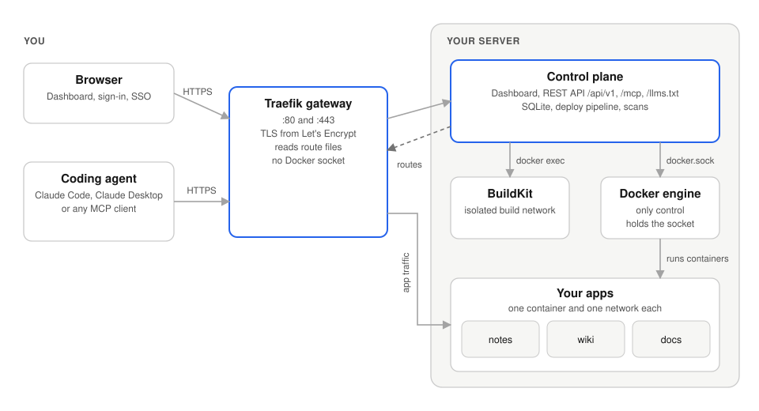

# Architecture

<p align="center">
  <picture>
    <source media="(prefers-color-scheme: dark)" srcset="images/architecture-dark.svg">
    
  </picture>
</p>

- [The pieces](#the-pieces)
- [What happens in a deploy](#what-happens-in-a-deploy)
- [Networks](#networks)
- [Tech stack](#tech-stack)
- [Repository layout](#repository-layout)
- [Working on Runway](#working-on-runway)

## The pieces

Four things run on the server, all from `docker-compose.yml`:

- **Gateway (Traefik).** Terminates TLS with Let's Encrypt certificates and routes
  hostnames to the control plane and to apps. It uses the file provider: control writes
  one YAML route file per app (and one for the dashboard) into a shared volume, and
  Traefik watches it. Traefik has no access to the Docker socket.
- **Control plane.** One Node.js process: the dashboard (server-rendered with htmx), the
  REST API under `/api/v1`, the MCP skill server at `/mcp`, `/llms.txt`, the deploy
  pipeline, the schedulers (rebuilds, rescans, quarantine, health, host figures) and the
  SQLite database. It is the only container that holds the Docker socket.
- **BuildKit.** Builds images. Control starts a build by running `buildctl` inside this
  container through the Docker socket, so BuildKit needs no network path to control or to
  apps.
- **Your apps.** One container per app, on a network of its own.

## What happens in a deploy

1. The client sends the source as a tar to `POST /api/v1/app/deploy`. Control streams it
   to disk under a size limit and checks every entry before using it.
2. BuildKit builds the image. `RUN` steps run in its sandbox.
3. Control scans with Trivy: the source for secrets and misconfigurations, the built image
   for vulnerabilities. If a finding meets the app's scan threshold, the deploy is
   **blocked**: the image is never started and the running container keeps serving.
4. Control creates the app's network and attaches the gateway to it, then starts the new
   container with the app's environment, volumes, health check, memory and CPU limits and
   the hardening profile, replacing the old one.
5. Control writes the Traefik route file, so the app is reachable on its hostnames.
6. The deploy, its scan and the base images it used are recorded, an event is written and
   the webhook is told about failures.

A rebuild takes the same path from the stored source with the cache off, with two
differences: it must not be worse than the running version, and the new container must
become healthy or the previous one is put back.

## Networks

| Network | Holds | Why |
|---|---|---|
| `runway-internal` | control and the gateway | The dashboard and forward-auth. Apps cannot reach control. |
| `runway-net-<id>` | one app and the gateway | One per app, so apps cannot reach each other and skip SSO or basic auth. |
| `runway-build` | BuildKit | `RUN` steps cannot reach control, the gateway or apps. |
| `runway-apps` | apps deployed before per-app networks | Kept until those apps are redeployed. |

Per-app networks use subnets cut from `10.250.0.0/16` (`RUNWAY_APP_NET_POOL`), because
Docker's own default pools run out after about 30 networks. What apps may reach outside
Docker is a host firewall matter, see
[Operations](operations.md#limit-what-apps-can-reach-egress-rules).

## Tech stack

| Component | Technology |
|---|---|
| Language | TypeScript |
| Runtime | Node.js 24, with `node:sqlite` |
| Web framework | [Hono](https://hono.dev/) and [htmx](https://htmx.org/) |
| Containers | [dockerode](https://github.com/apocas/dockerode) and [BuildKit](https://github.com/moby/buildkit) |
| Reverse proxy | [Traefik](https://traefik.io/) with the file provider |
| TLS | Let's Encrypt, HTTP-01 |
| Scanning | [Trivy](https://trivy.dev) and the CISA KEV catalogue |
| Agent protocol | [MCP](https://github.com/modelcontextprotocol/typescript-sdk) |
| Agent discovery | `/llms.txt` (plain Markdown) |

The dashboard is server-rendered HTML with a small set of design tokens and components in
one stylesheet. There is no front-end build step and no SPA framework.

## Repository layout

```
runway/
├── install.sh             # One-command server bootstrap
├── docker-compose.yml     # Traefik, control plane, BuildKit
├── packages/
│   ├── control/           # Dashboard, REST API, deploy pipeline
│   └── mcp/               # Local MCP server (one app, or several Runways)
├── scripts/
│   ├── backup-db.sh       # SQLite snapshot
│   └── egress-rules.sh    # Host firewall rules for app containers
├── docs/                  # This documentation
├── CLAUDE.md              # Notes for coding agents working on this repo
└── LICENSE
```

## Working on Runway

You need Node.js 24 and pnpm.

```bash
pnpm install
pnpm typecheck
pnpm test                            # vitest, about 1,700 tests
pnpm --filter @runway/control dev    # dashboard on http://localhost:3000
pnpm mcp:build                       # build the local MCP server
```

The suite covers pure functions, routes and database migrations. Some tests unpack real
tars and set file owners, which fails on macOS (BSD tar, and no root). Run the whole
suite on Linux in a clean container instead:

```bash
git archive HEAD | docker run --rm -i node:24-slim bash -c \
  'mkdir /w && tar -x -C /w && cd /w && corepack enable \
   && pnpm install --frozen-lockfile && pnpm test'
```

Without Docker on the host, `/var/run/docker.sock` is missing, so a local dev server shows
apps by their stored status and the health page reports Docker as unreachable. That is
expected.

Contributions are welcome: see [CONTRIBUTING.md](../CONTRIBUTING.md). Branch from
`develop`, open the pull request against `develop`, and keep changes small. The
non-obvious decisions behind the code, each one the result of an incident, are written
down in [CLAUDE.md](../CLAUDE.md).
