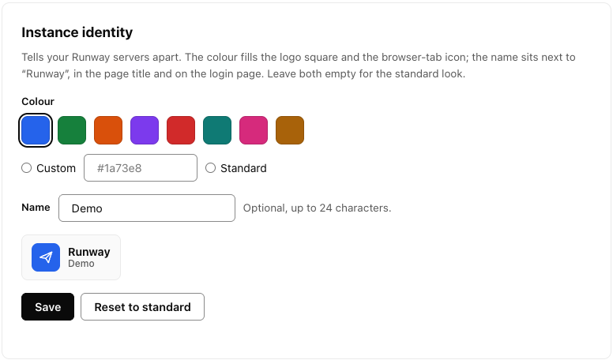

# Configuration

Runway is configured in three places: the installer (once), the `.env` file
next to `docker-compose.yml`, and the **Settings** page of the dashboard. Most
installs never touch more than the dashboard.

- [The installer](#the-installer)
- [`.env` and environment variables](#env-and-environment-variables)
- [Settings in the dashboard](#settings-in-the-dashboard)
- [Where state lives](#where-state-lives)

## The installer

`install.sh` asks for two values and accepts a few optional ones as
environment variables:

| Variable | Default | Meaning |
|---|---|---|
| `DASHBOARD_DOMAIN` | asked | Hostname of the dashboard, for example `runway.example.com`. Its DNS A record must already point at the server. |
| `ACME_EMAIL` | asked | Email for the Let's Encrypt account and expiry notices. |
| `RUNWAY_EGRESS` | `0` | Set to `1` to also install the host egress rules for app containers (see [Operations](operations.md#limit-what-apps-can-reach-egress-rules)). |
| `RUNWAY_REPO` | the GitHub repository | Git repository to clone. |
| `RUNWAY_VERSION` | `main` | Branch, tag or commit to check out. |
| `RUNWAY_DIR` | `/opt/runway` | Install directory. |

Unattended install:

```bash
curl -fsSL https://raw.githubusercontent.com/wiggertdehaan/Runway/main/install.sh \
  | sudo DASHBOARD_DOMAIN=runway.example.com ACME_EMAIL=you@example.com bash
```

What it does: installs Docker if it is missing (Ubuntu, Debian, CentOS, RHEL,
Fedora, Rocky, Alma), opens ports 22, 80 and 443 with `ufw` or `firewalld` when
one of them is present, clones the repository, writes `.env` (mode 600) with
`DASHBOARD_DOMAIN`, `ACME_EMAIL` and a fresh `SETUP_TOKEN`, starts the stack
with `docker compose up -d --build`, and waits up to two minutes for Let's
Encrypt to issue the dashboard certificate. It prints the setup token once at
the end.

Requirements: a domain with an A record to the server, a wildcard record
(`*.runway.example.com`) so every app gets a subdomain, and ports 80 and 443
reachable from the internet.

## `.env` and environment variables

`docker-compose.yml` reads `.env` and passes the variables below to the control
container. An empty value means "use the built-in default", so you only set the
ones you want to change, then run `docker compose up -d` from the install
directory.

Required:

| Variable | Meaning |
|---|---|
| `DASHBOARD_DOMAIN` | Dashboard hostname. |
| `ACME_EMAIL` | Let's Encrypt account email. |

Setup and access:

| Variable | Default | Meaning |
|---|---|---|
| `SETUP_TOKEN` | generated | One-time token that `/setup` asks for until the first admin account exists. `install.sh` writes one into `.env`. If it is empty, control generates one on first start and prints it in its log (`docker logs runway-control 2>&1 \| grep -i "setup token"`). It stops doing anything once an admin exists. |

Rate limits (per API key or MCP token, see [Security](security.md#rate-limits)):

| Variable | Default | Meaning |
|---|---|---|
| `RATE_LIMIT_READ_PER_MIN` | `120` | Reads per minute. |
| `RATE_LIMIT_WRITE_PER_MIN` | `60` | Writes per minute. |
| `RATE_LIMIT_HEAVY_PER_10MIN` | `10` | Deploy, rollback and source download per 10 minutes. |
| `RATE_LIMIT_AUTH_FAIL_PER_10MIN` | `20` | Unknown keys from one address per 10 minutes before that address is blocked. |
| `API_IP_RATE_LIMIT` | `600` | Coarse per-address flood guard, requests per minute. |

Containers and networks:

| Variable | Default | Meaning |
|---|---|---|
| `RUNWAY_HARDENING` | `standard` | `standard`, `strict` or `relaxed`. `relaxed` is an emergency brake that switches the capability, PID and read-only rules off for every app at its next deploy or rebuild. |
| `RUNWAY_PIDS_LIMIT` | `512` | Tasks (threads included) per app container. |
| `RUNWAY_APP_NETWORK_MODE` | per-app networks | `shared` puts new deploys back on the shared `runway-apps` network. Emergency brake only. |
| `RUNWAY_APP_NET_POOL` | `10.250.0.0/16` | Private range the per-app networks are cut from. Change it only if it collides with something on the host. |
| `RUNWAY_APP_NET_PREFIX` | `28` | Prefix length of each per-app subnet. |
| `BUILDKIT_GC_KEEPSTORAGE` | `2000,8000,6000` | BuildKit cache cap in MB: reserved, minimum free, maximum used. |

Uploads and sources:

| Variable | Default | Meaning |
|---|---|---|
| `RUNWAY_TAR_MAX_ENTRIES` | `100000` | Most entries in an uploaded source tar. |
| `RUNWAY_TAR_MAX_PATH` | `1024` | Longest path in a source tar. |
| `RUNWAY_TAR_MAX_DEPTH` | `128` | Deepest nesting in a source tar. |
| `RUNWAY_SOURCE_RETENTION` | `10` | Source snapshots kept per app. |

The upload size limit itself is a dashboard setting (default 100 MB).

Scans, events and the overview:

| Variable | Default | Meaning |
|---|---|---|
| `PERIODIC_SCAN_INTERVAL_HOURS` | `24` | Hours between the background scans of running apps. |
| `EVENTS_RETENTION_DAYS` | `60` | How long events are kept. |
| `EVENTS_MAX_PER_APP` | `500` | Most events kept per app. |
| `HEALTH_WATCH_INTERVAL_MS` | one look a minute | Health watcher behind the `health_unhealthy` and `health_recovered` events. `0` turns it off. |
| `HOST_METRICS_INTERVAL_MS` | every minute | Host disk, CPU, memory and Docker data readings for the overview. Disk is read every 5 minutes and Docker data every 15. `0` turns it off. |
| `AUDIT_API_RETENTION_DAYS` | `90` | How long API and MCP lines stay in the audit log. |
| `AUDIT_API_MAX_ROWS` | `100000` | Most API and MCP lines kept. Lines about people in the dashboard are never pruned. |

A value that does not parse falls back to the default instead of failing.

## Settings in the dashboard

Admins find these under **Settings**:

- **Base domain**: the domain apps get subdomains of.
- **Instance identity**: a colour and a short name that tell your Runways apart.
  The colour fills the logo and the browser-tab icon, the name sits next to
  "Runway", in the page title and on the login page.

  

- **Notifications**: a webhook that receives deploy failures, rebuild results,
  quarantine notices and new severe findings.
- **Scan floor**: the lowest scan threshold any app may use.
- **Upload limit**: the largest source upload (default 100 MB).
- **Image retention**: how many image versions are kept per app.
- **Single Sign-On**: Google and Microsoft OAuth2 client credentials.

The rebuild schedule and the KEV quarantine term are on the **Rebuild** page.
Per-app settings (scan threshold, automatic maintenance, hardening profile,
owner, domain, health check, SSO) are on the app page.

## Where state lives

All state is in Docker volumes:

| Volume | Holds |
|---|---|
| `control-data` | The SQLite database, KEV cache, uploads in progress, stored source snapshots. |
| `gateway-config` | Traefik route files written by control. |
| `gateway-data` | The Let's Encrypt certificates (`acme.json`). |
| `gateway-logs` | Traefik's access log, tailed for per-app activity. |
| `buildkit-cache` | The BuildKit build cache. |
| `build-exchange` | Hand-over folder between control and BuildKit. |
| `trivy-cache` | Trivy's vulnerability database (about 500 MB). |

To back up the database run `scripts/backup-db.sh` (it uses SQLite's `.backup`
for a consistent snapshot and keeps the last 7 copies). Back up the `gateway-data`
volume too if you want to keep the issued certificates.
