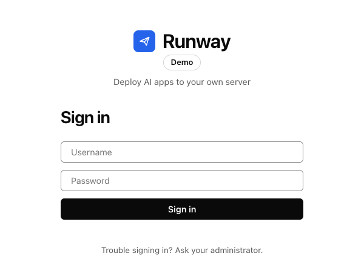
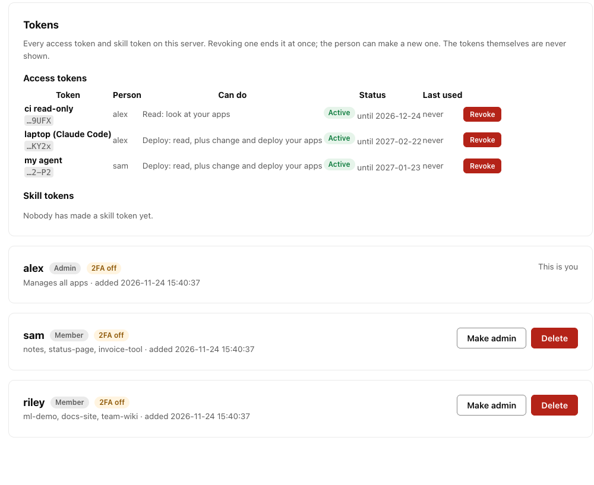
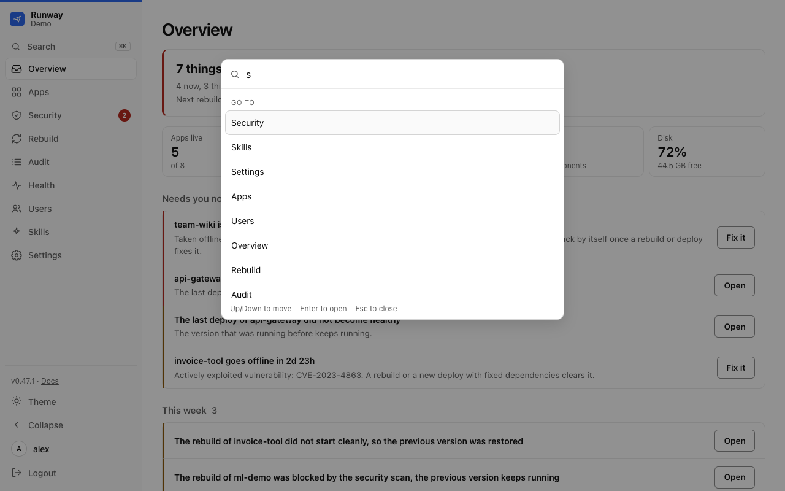

# Deploying and running apps

How to get an app onto Runway and what you can set on it afterwards. For the
agent side (MCP tools, tokens, events) see [MCP and agents](mcp.md). For keeping
apps patched see [Operations](operations.md).

- [Deploy an app](#deploy-an-app)
- [Environment variables](#environment-variables)
- [Persistent volumes](#persistent-volumes)
- [Custom domains](#custom-domains)
- [Health checks](#health-checks)
- [Deploy history and rollback](#deploy-history-and-rollback)
- [Pull project source](#pull-project-source)
- [Basic auth](#basic-auth)
- [Single Sign-On](#single-sign-on)
- [Users, roles and ownership](#users-roles-and-ownership)
- [Security scanning](#security-scanning)
- [The overview and security pages](#the-overview-and-security-pages)

## Deploy an app

The shortest path needs no install on your machine:

1. In the dashboard click **New app**. You get an API key (`rwy_...`) and a
   ready-made deploy instruction.
2. Open your project in Claude Code and paste the instruction.
3. Claude reads `https://<your-runway>/llms.txt`, adds a Dockerfile if the
   project has none, uploads the source as a tar and reports the live URL and
   any scan findings.

`/llms.txt` is plain Markdown served by your Runway. It documents the whole API
and starts with a "Before you start building" section: runtime-agnostic
guardrails (run as non-root, pin versions, add a health check) and a checklist
per runtime, so the first deploy tends to pass the security scan.

The same API is open to any HTTP client. A deploy is a `POST /api/v1/app/deploy`
with the source as an `application/x-tar` body and the app key as a Bearer
token. The upload is streamed to disk with a size limit (100 MB by default,
adjustable under **Settings**), and the tar is checked before anything is
unpacked: no gzip, no absolute paths or `..`, no links that leave the project, no
device files, and limits on entries, path length and depth.

The server builds whatever Dockerfile is in the upload. For projects that have
none, `/llms.txt` publishes tested templates for four runtimes (`node`, `python`,
`go` and `static` on nginx), and the MCP tool `runway_package` generates one
locally. Bring your own Dockerfile for full control. Apps listen on port 3000 by
default, or 80 for `static`.

Other ways in:

- the **built-in skill server** for Claude Code (`/mcp`), see [MCP and agents](mcp.md#skill-server)
- the **local MCP server** with typed tools, for one app or for several apps on
  several Runways, see [MCP and agents](mcp.md)

## Environment variables

Store secrets and configuration on the server, never in your image. Set them in
the dashboard, through the API or through the MCP tools. They are stored in
SQLite and injected when the container starts, so a change takes effect at the
next deploy. Anyone who can sign in to the dashboard as the app's owner or an
admin, and anyone holding the app's key, can read them.

## Persistent volumes

Mount paths inside the container that survive redeploys. They are named Docker
volumes, which suits SQLite databases, uploads and caches. Mount paths are
validated against a strict character allowlist.

## Custom domains

Every app gets `<name>.<base domain>`. You can add one custom domain per app:
point its DNS at the server and set it in the app's **Access** tab. Traefik
issues a Let's Encrypt certificate automatically. A domain can belong to one app
only: Runway refuses a second app that asks for the same name, and treats
upper and lower case, and a trailing dot, as the same name.

## Health checks

Set an HTTP path to probe on the app's **Config** tab. Docker checks it every 30 seconds and marks the
container unhealthy after 3 failures. A health watcher turns the transitions
into `health_unhealthy` and `health_recovered` [events](mcp.md#events). On a
rebuild the new container must become healthy within two minutes or the previous
version is put back.

## Deploy history and rollback

Every deploy is recorded with its image tag, status, scan summary and the base
images it used. The app page lists the last 20 deploys with a **Restore** button
on every successful one. A blocked or failed deploy says in one line why.
Rollback is also in the API (`GET /app/deploys`, `POST /app/rollback` with an
optional `deploy_id`) and the MCP (`runway_list_deploys`, `runway_rollback`).
Environment variables, volumes and domain config stay as they are; only the
image changes.

## Pull project source

Runway keeps the build context of every successful deploy (the last 10 by
default, `RUNWAY_SOURCE_RETENTION`), so you can pull a codebase back to a fresh
machine without a separate git host. Download a snapshot from the deploy history,
with `GET /app/source` (optional `?deploy=<id>`) or with `runway_pull`. The tar is
the uploaded file set after `.dockerignore` and `.gitignore` filtering, so there
is no `.git` history: run `git init` after extracting.

## Basic auth

Put HTTP basic auth in front of any app at the gateway with one switch in the
dashboard or one MCP call. Credentials are hashed before they reach disk and the
route is rewritten on the fly, with no redeploy. It suits an internal tool. For
more than one user, use SSO.

## Single Sign-On

An admin adds Google or Microsoft OAuth2 client credentials under **Settings**.
The login page then shows provider buttons next to the password form.

  <picture>
    <source media="(prefers-color-scheme: dark)" srcset="images/login-dark.png">
    
  </picture>

For deployed apps, SSO is a gateway-level check. Switch on **SSO protection** on
the app's **Access** tab and manage an email allowlist: only people with a
matching Runway account can reach the app. Traefik's forward-auth asks Runway on
every request, so the app needs no code for it. If both SSO and basic auth are
on, SSO wins.

How it works, and what to know:

- **Who may sign in.** A person who already has a Runway account can sign in with
  Google or Microsoft when the provider confirms the email address. Nobody gets
  an account just by owning a Google or Microsoft account: a new person needs an
  entry on the **allowlist** (an address, or a whole domain you control) or a
  one-use **invitation**, both managed on the **Users** page. Refusals all show
  the same message and are written to the audit log as `oauth_denied` with the
  reason. Microsoft only counts as verified when the optional `xms_edov` claim is
  present in the ID token, so enable it in the Entra app registration if you use
  Microsoft.
- **Two cookies, never shared.** The dashboard session cookie is host-only
  (`__Host-` prefixed over HTTPS), so a deployed app never receives it. Each SSO
  app host, the Runway address and a custom domain alike, gets its own
  short-lived cookie after a one-time redirect through the dashboard, valid for
  that host only. Signing out of the dashboard ends them all.
- **The `X-Forwarded-User` header** is set only by forward-auth. Runway removes
  any such header sent by a visitor for every app, SSO or not.

## Users, roles and ownership

There are two roles. The first account, created in the setup wizard, is an admin.
Admins manage people on the **Users** page: who has which apps, who has 2FA, the OAuth
allowlist and every token on the server.

  

| Can | Admin | Member |
|---|---|---|
| Create, configure, deploy, roll back and delete apps | all apps | their own apps |
| Rebuild and rescan | any app | their own apps |
| Environment variables, volumes, domain, health check, scan threshold | all apps | their own apps |
| Overview and Security pages | everything | only their own apps |
| Change own password and 2FA | yes | yes |
| Users, Settings, Audit, Skills, Rebuild and Health pages | yes | no |
| Automatic maintenance, hardening profile, owner assignment, KEV exemptions | yes | no |

Ownership is by user id: renaming or deleting a user never hands their apps to a
new person with the same name. When an owner is deleted their apps become
ownerless and are managed by admins until one assigns a new owner on the app's
**Config** tab.

Two-factor authentication (TOTP, with ten single-use backup codes) is optional per
user. After five wrong codes the account locks for a growing time. An admin can
unlock it on the **Users** page.

## Security scanning

Every deploy is scanned with [Trivy](https://trivy.dev) before the new container
replaces the old one, in three passes:

- **Image vulnerabilities**: OS packages and language dependencies against the
  CVE database.
- **Secrets in source**: hardcoded API keys, tokens and credentials.
- **Dockerfile misconfigurations**: running as root, no `HEALTHCHECK`, remote
  `ADD` and similar.

Each app has a `scan_threshold` (`none`, `low`, `medium`, `high`, `critical`).
When a finding meets it the deploy is blocked: the image is built but never
started and the running container keeps serving. Findings are in the deploy
response, on the app page and in `runway_get_scan`. An admin-set **scan floor**
under **Settings** is the lowest threshold any app may use.

A background rescan runs Trivy against every running app's image once a day (see
`PERIODIC_SCAN_INTERVAL_HOURS`), so CVEs published after the gate still show up.
A new HIGH or CRITICAL finding fires the webhook. An admin or the app's owner can
rescan on demand, one rescan at a time. Actively exploited vulnerabilities
(CISA KEV) start a countdown, see [Operations](operations.md#kev-countdown-and-quarantine).

## The overview and security pages

`/overview` says in five seconds whether all is well and, if not, what to do. It
shows a row of figures, an inbox sorted by urgency (needs you now, this week, for
your information), each line with one button, and statistics for 24 hours, 7 days
or 30 days: new apps, deploys, rebuilds, new KEV findings and hits. Admins also
see the server's disk, CPU, memory and Docker data, see
[Operations](operations.md#server-figures). `/security` lists every app with an
actively exploited vulnerability or a finding worth reading. A member sees only
their own apps on both pages, with no server information.

Press `Ctrl K` (`Cmd K` on a Mac) anywhere to open the command palette. It jumps
to pages and to the apps you may see.

  <picture>
    <source media="(prefers-color-scheme: dark)" srcset="images/palette-dark.png">
    
  </picture>

